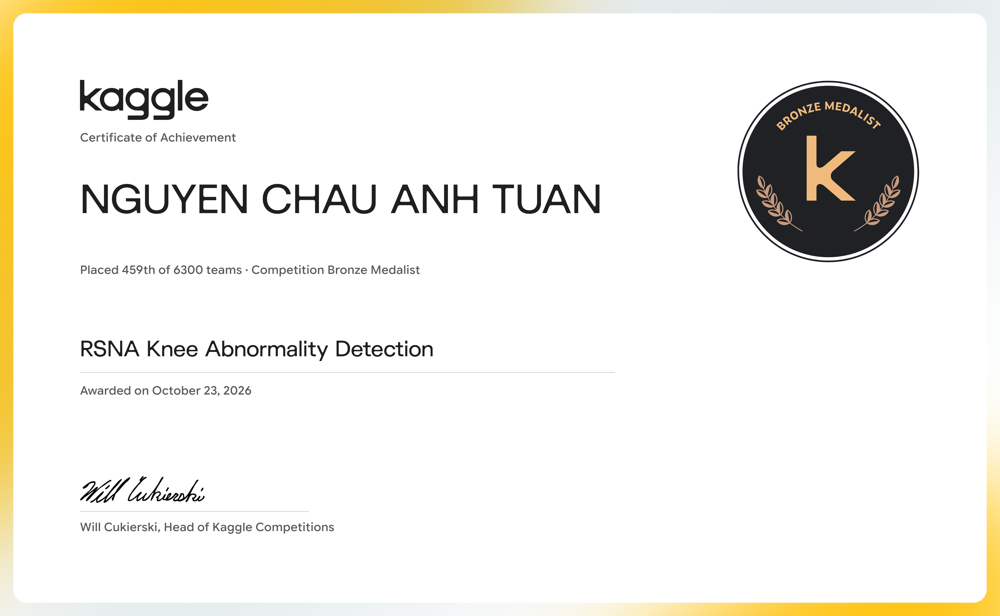

# RSNA 2026 — Bronze Medal

Competition notebooks, experiment code, and research notes for [RSNA Knee Abnormality Detection](https://www.kaggle.com/competitions/rsna-knee-abnormality-detection).

## Competition result

| | Result |
|---|---|
| Competitor | Nguyen Chau Anh Tuan |
| Award | **Bronze Medal** |
| Final placement | **459 / 6,300 teams** (top 7.29%) |
| Award date | October 23, 2026 |

The placement and award above are documented in the Kaggle certificate below.



## Project overview

This archive follows the development of knee MRI abnormality detection pipelines: data and label audits, slice and series selection, multiple instance learning (MIL), pretrained image encoders, and ensemble inference. It preserves both successful runs and exploratory experiments.

The experiments include DenseSlice MIL, RadImageNet encoders, CoAtNet and ConvNeXt branches, and later R6/Raptor inference pipelines with an S6 component. Later probes examine slice density, anatomical mirroring, crop augmentation, rank blending, probability blending, and per-target postprocessing.

## Start here

| Files | Purpose |
|---|---|
| [Final assessment and selection notes](45_Final_Assessment_and_Selection.md) | Recorded evidence, candidate comparisons, and validation limitations |
| [Notebook 33 notes](33_RSNA_0958_R6_Raptor_Notes.md) | R6/Raptor anchor provenance and input requirements |
| [Notebook 39 run instructions](39_Run_Instructions.md) | Kaggle setup and the fixed S6 rank blend |
| `33_*`, `39_*`, `40B_*` notebooks | Later submission candidates preserved in the archive |
| `45A_*`–`45E_*` notebooks | Final fusion experiments; their presence does not identify the medal submission |
| `build_*.py`, `validate_*.py`, `test_*.py` | Notebook builders and implementation checks |
| `results*.zip`, `*_Artifacts.zip`, `research_*` | Saved outputs, checkpoints, source snapshots, and supporting evidence |

The historical notes report a rounded public leaderboard score of 0.958 for several later candidates. That public score is separate from the final placement shown in the certificate. This archive does not establish which exact selected notebook produced the final ranking or record a verified private leaderboard score.

## Restore the archive

Install Git and [Git LFS](https://git-lfs.com/), then run:

```bash
git lfs install
git clone https://github.com/ncat218/RSNA_2026_Bronze_medal.git
cd RSNA_2026_Bronze_medal
git lfs pull
```

ZIP archives and `.pt` checkpoints use Git LFS. A clone without the LFS objects contains pointer files in their place. Python bytecode caches and incomplete `.download` files are excluded.

## Running the notebooks

The submission notebooks target Kaggle. Check each notebook's metadata and accompanying run instructions for its exact competition inputs, external datasets, checkpoint versions, and GPU settings. For example, the notebook 39 instructions specify T4 ×2 GPUs, Internet off, and pinned input versions.

This repository is an experiment archive, not a self-contained training dataset. Reproducing a run requires obtaining its referenced Kaggle inputs and observing the access conditions for those sources. Local syntax, hash, and fusion checks do not replace a complete Kaggle GPU run.

## Credits

The research builds on community notebooks, model weights, and datasets referenced in the notebook metadata and provenance notes, including Raptor, R6/OrthoFoundation, S6, RadImageNet, CoAtNet, and ConvNeXt resources. Those third-party assets retain their original licenses and usage conditions. See the individual notebooks and research notes for source attribution.
