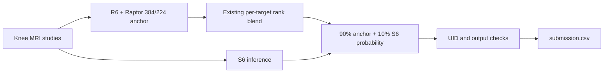

# RSNA Knee Abnormality Detection — Bronze Medal

**459 / 6,300 teams · Top 7.29% · Kaggle 2026**  
Nguyen Chau Anh Tuan

A solution writeup and reproducible submission entry point built around **notebook 40B**, identified by the author as the submission behind the final placement.

**[Read the solution](docs/solution.md) · [Run the notebook](docs/reproduction.md) · [Experiment notes](docs/experiments.md)**

## Approach

The solution combines an R6/Raptor anchor with an S6 branch for 12 knee MRI findings. The final fusion retains 90% of the anchor output and adds 10% of the raw S6 probabilities.



The work presented here focuses on integrating community models, comparing fusion choices, preserving checkpoint provenance, and making the inference run auditable. Model sources and pretrained weights are credited in the [solution](docs/solution.md#credits-and-scope).

## Result

| Measure | Result / evidence |
|---|---|
| Final placement | **459 / 6,300 teams**, Bronze Medal |
| Final submission | **40B**, as confirmed by the author |
| Historical Public LB | **0.958**, rounded score reported during the competition |
| Private LB score | Not recorded here; final placement is supported by the certificate |

<details>
<summary>Kaggle achievement certificate — October 23, 2026</summary>


</details>

## Repository guide

| Path | Contents |
|---|---|
| [docs/solution.md](docs/solution.md) | Pipeline, fusion rationale, reliability and limitations |
| [docs/experiments.md](docs/experiments.md) | Selected experiments and what the evidence supports |
| [docs/reproduction.md](docs/reproduction.md) | Kaggle inputs, execution steps and output checks |
| [notebooks/final_submission_40B.ipynb](notebooks/final_submission_40B.ipynb) | Original archived 40B notebook, without code edits |
| [src/fusion.py](src/fusion.py) | Final fusion function extracted verbatim for inspection and testing |
| [configs/submission.json](configs/submission.json) | Notebook checksum, fusion weights and original Kaggle metadata |
| [tests/test_fusion.py](tests/test_fusion.py) | Lightweight checks of identity alignment, fallback and invalid inputs |

Full GPU inference runs through the notebook. The extracted fusion module is independently testable:

```bash
python -m pip install -r requirements.txt
python -m unittest discover -s tests -v
```

The complete competition history, older notebooks, ZIP outputs and checkpoints remain on the [`archive/competition-snapshot-2026-11-03`](https://github.com/ncat218/RSNA_2026_Bronze_medal/tree/archive/competition-snapshot-2026-11-03) branch. The main branch is a focused presentation of the final solution.

Competition: [RSNA Knee Abnormality Detection](https://www.kaggle.com/competitions/rsna-knee-abnormality-detection).
