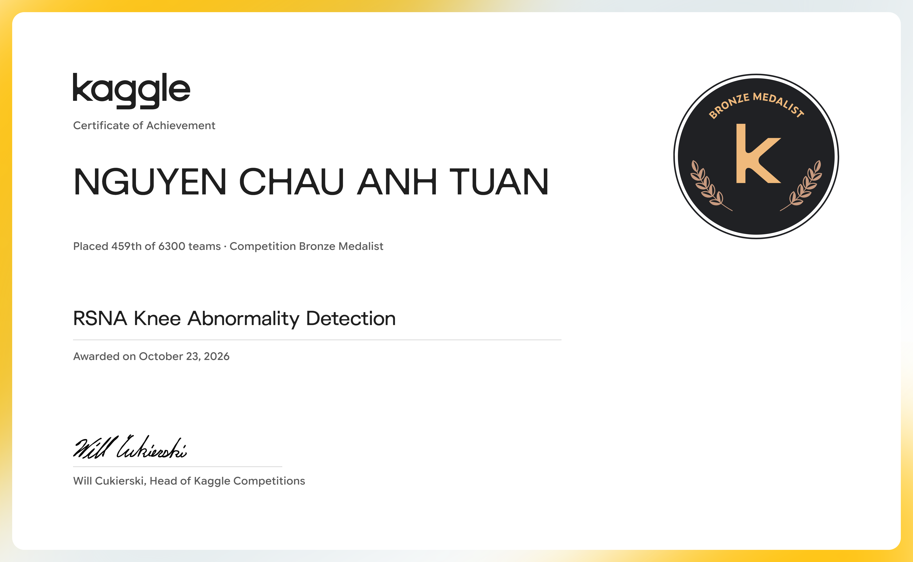
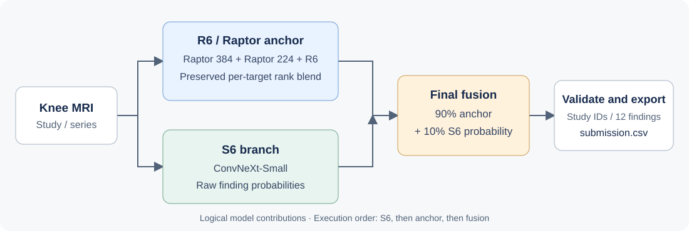

# RSNA Knee Abnormality Detection — Bronze Medal Solution

**Nguyen Chau Anh Tuan · 459 / 6,300 teams · Top 7.29% · Kaggle 2026**

This is my solution to [RSNA Knee Abnormality Detection](https://www.kaggle.com/competitions/rsna-knee-abnormality-detection), centered on my final submission, **notebook 40B**. It combines a frozen R6/Raptor anchor with an S6 inference branch, using a fixed 90/10 blend of the anchor scores and raw S6 probabilities.

The work focuses on integrating pretrained community pipelines, comparing controlled ensemble variants, and making inference reproducible through pinned inputs, identity checks, receipts and explicit failure handling.

## 0. Overview

The task is to predict 12 findings from a knee MRI study. A study can contain multiple series and many slices, so the pipeline must handle both image inference and reliable aggregation to a single prediction per study and finding.

| Findings | Targets |
|---|---|
| Ligaments | ACL, MCL |
| Menisci | Medial Meniscus, Lateral Meniscus |
| Osteoarthritis | Medial OA, Lateral OA, PF OA |
| Other findings | Effusion, Synovitis, Baker's, Contusion, Fracture |

My final approach uses two complementary inference paths. The first is the existing R6/Raptor ensemble from notebook 33. The second is the S6 model branch. Notebook 40B preserves the anchor and changes how S6 contributes at the final fusion step.



The two stages run sequentially in separate processes: **S6 first, then the anchor**, followed by study alignment, fusion and submission validation. The diagram shows their logical contributions, rather than concurrent execution.

## 1. Models and inference

### 1.1 R6/Raptor anchor

The anchor combines Raptor models at **384** and **224** resolution with the pinned **R6** pipeline. It retains the original mirror test-time augmentation and per-target blending from notebook 33.

The anchor output is already a blended score. Notebook 40B keeps the internal anchor models, weights and preprocessing unchanged so that the final S6 experiment can be evaluated without simultaneously changing the base pipeline.

| Component | Role in 40B |
|---|---|
| Raptor 384 | Higher-resolution Raptor inference path |
| Raptor 224 | Second Raptor resolution within the existing ensemble |
| R6 frozen v1/w1 bundle | Pinned inference pipeline with its existing augmentation and blending |
| Anchor fusion | Original per-target rank blend, preserved from notebook 33 |

### 1.2 S6 branch

The S6 branch adds predictions from a pinned pretrained checkpoint and its associated code/anatomy resources. The embedded inference configuration is:

| Setting | Value |
|---|---|
| Backbone | ConvNeXt-Small |
| Input size | 320 |
| Crop | 288 |
| Views | v4 |
| Slices | 3 |
| Physical spacing configuration | 3.5 mm |
| Precision | FP16 |
| Checkpoint | `E_prior_s42_fall.pt` |
| S6 weights dataset | Version 5 |

These are the settings inherited by the submitted notebook. The full preprocessing and model implementations remain embedded in [the original 40B notebook](notebooks/final_submission_40B.ipynb), together with checkpoint hashes and input metadata.

### 1.3 Training scope

Notebook 40B performs inference and fusion; it does not train new models or fit new weights on the gold labels. The repository's earlier experiments explored DenseSlice MIL, RadImageNet, CoAtNet, ConvNeXt and weak-label training, but those experiments should not be read as the training recipe for the community checkpoints used in this final ensemble.

## 2. Final ensemble

### 2.1 Why compare ranks and probabilities?

Notebook 39 combined the unchanged anchor with **S6 percentile ranks**. Ranking makes the S6 contribution depend on relative order, while discarding the spacing between its confidence values.

For 40B, I tested a single change: retain the S6 weight at 10%, but use its **raw probabilities**. The hypothesis was that the confidence spacing could contribute useful information to the ensemble.

For study `i` and finding `k`, when S6 inference succeeds:

```text
prediction[i, k] = 0.90 * anchor33[i, k] + 0.10 * s6_probability[i, k]
```

The corresponding implementation is extracted in [src/fusion.py](src/fusion.py). The anchor already contains its own rank blending, so this final operation mixes score representations. Calibration mismatch is a tradeoff; the final placement alone does not prove that probability blending outperformed the rank variant.

### 2.2 Alignment and fallback

Before blending, the controller aligns predictions by `StudyInstanceUID` and finding name. It checks for duplicate or missing IDs, incorrect column order, nonfinite values and predictions outside [0, 1].

If an S6 study fails within the permitted failure allowance, that study retains its **anchor-only prediction**. An unknown failed ID, excessive failures, or invalid outputs cause the run to fail. Fallbacks are written into the audit instead of being counted as complete S6 coverage.

## 3. Experiments and selection

The table below summarizes the late experiments most relevant to the final submission. Public scores are the rounded values recorded during the competition.

| Notebook | Change | Recorded result |
|---|---|---|
| 33 | R6/Raptor anchor | Public LB 0.958 |
| 39 | 90% anchor + 10% S6 percentile rank | Public LB 0.958 |
| 40A | Increase the S6 rank contribution to 20% | Controlled weight probe; no final ranking recorded here |
| **40B** | **90% anchor + 10% raw S6 probability** | **Final submission; Bronze Medal, 459/6,300**; Public LB 0.958 |
| 43A / 43B | S6 standalone, with center-only / crop-TTA variants | Public LB 0.950 |
| 44A | Remove the effusion fluid stacker | Intended single-target change verified in saved output; Public LB 0.958 |

The comparison between 39 and 40B holds the 10% S6 contribution fixed and changes its representation. Other experiments examined slice density, mirroring, crop augmentation and postprocessing.

The most useful lessons from this sequence were:

- **Change one factor at a time.** Keeping stage sources and checkpoint identities fixed made the fusion experiment easier to inspect.
- **Inspect component behavior as well as the final score.** Standalone performance does not establish how useful a model's errors will be in an ensemble.
- **Separate regression checks from performance evaluation.** A valid CSV and matching visible predictions establish implementation behavior, not hidden-set AUC.
- **Treat rounded leaderboard scores carefully.** Several candidates displayed 0.958; that does not establish equal full-precision performance or private-set quality.

The 58 gold studies were examined repeatedly during development, and Public LB feedback influenced experimentation. Those diagnostics are not an untouched holdout for selecting the final blend. This limits the strength of conclusions about individual ablation gains.

## 4. Engineering the submission

### 4.1 Input and checkpoint preflight

Before spending GPU time, the notebook resolves its required input mounts and checks the identities of key checkpoint, code and manifest files. This guards against silently attaching a newer or different model bundle.

In particular, the R6 input must be the original **v1/w1 frozen bundle**, while S6 must use **Version 5**. Substituting R7 or a latest dataset version changes the experiment.

### 4.2 Process isolation and runtime guards

S6 and the anchor run as separate subprocess stages with their own logs. The controller records stage times and script hashes, monitors time budgets, and attempts to clean up surviving worker processes after each stage.

The global eight-hour deadline is a safety cap, not a measured runtime estimate. Saved runs on a few visible studies cannot be extrapolated to the complete hidden test set.

### 4.3 Submission integrity

The final output is written to a pending CSV, read back for identity and finite-value checks, and then moved into the final `submission.csv` location. A failed run removes the partial final submission and writes a FAILED audit.

A successful audit includes the row count, stage details, fallback warnings and submission checksum. `COMPLETE` can still contain reported fallbacks, so the warning fields must also be inspected.

## 5. Competition result

| Measure | Result |
|---|---|
| Award | **Bronze Medal** |
| Final placement | **459 / 6,300 teams — top 7.29%** |
| Final submission | **Notebook 40B** |
| Recorded Public LB | **0.958**, rounded |
| Private LB score | Not recorded in this repository |
| Award date | October 23, 2026 |

The certificate at the top documents the final placement and medal. Notebook 40B is the final submission identified from my competition run. This solution has not undergone clinical validation.

## 6. Reproducing the submission

### 6.1 Required environment and inputs

Import [notebooks/final_submission_40B.ipynb](notebooks/final_submission_40B.ipynb) into Kaggle. Select **T4 ×2 GPUs**, turn **Internet off**, and attach the following inputs:

| Input | Required identity |
|---|---|
| RSNA Knee competition | Competition data through Kaggle |
| Nartaa Raptor publication SWA weights | `rsna-knee-publication-swa-weights-20261007`, Version 1; both 384 and 224 checkpoints |
| R6 frozen bundle | `rsna-knee-r6-frozen-fe055406-w1`, original v1/w1 bundle |
| Heliosli OrthoFoundation assets | `rsna-orthofoundation-fold0-epoch7-20261004`, Version 1 |
| Nartaa S6 weights | `rsna-knee-s6fall-weights`, Version 5 |

Original Kaggle dataset-version IDs and the archived notebook checksum are in [configs/submission.json](configs/submission.json). Inspect actual attachments after importing: notebook metadata may not attach every dataset automatically. No saved Output39 dataset is required.

### 6.2 Run and inspect outputs

1. Save a new Kaggle version and run all cells.
2. Require `40B COMPLETE` and audit `experiment = 40B_anchor33_S6_probability_0.1` with `status = COMPLETE`.
3. Inspect `warnings`, `s6_failed_uids`, the anchor receipt and both stage logs.
4. Check that `/kaggle/working/submission.csv` contains the expected test IDs and all 12 finding columns.

| Output | Location |
|---|---|
| Final submission | `/kaggle/working/submission.csv` |
| Controller audit | `/kaggle/working/rsna_39/39_run_audit.json` |
| Anchor predictions | `/kaggle/working/39_anchor33.csv` |
| S6 probabilities | `/kaggle/working/rsna_39/39_s6_probabilities.csv` |

The inherited `rsna_39` names are retained to preserve the stage code. The notebook's original introduction reflects its experimental status before submission; the result above describes the completed competition.

### 6.3 Lightweight checks

The extracted fusion tests can run independently of GPU inference:

```bash
git clone https://github.com/ncat218/RSNA_2026_Bronze_medal.git
cd RSNA_2026_Bronze_medal
python -m pip install -r requirements.txt
python -m unittest discover -s tests -v
```

The tests cover blend calculations, ID alignment, failed-row fallback, invalid inputs and notebook checksum integrity. The notebook and embedded scripts were also syntax-checked during repository preparation. Full DICOM/GPU inference was not rerun for this presentation update.

The original validation report is preserved in [docs/original_40B_validation.json](docs/original_40B_validation.json). It records an earlier file checksum that differs from the Git-archived notebook; the original pre-archive bytes are unavailable for comparison. The notebook in this branch preserves the archived Git blob unchanged.

## 7. Repository and experiment archive

```text
notebooks/final_submission_40B.ipynb  Original archived submission notebook
src/fusion.py                       Extracted final fusion function
configs/submission.json             Weights, metadata and notebook checksum
tests/test_fusion.py                 Lightweight correctness checks
docs/                               Certificate and supporting documentation
```

The full development history, previous notebooks, ZIP outputs and checkpoints are preserved on the [competition archive branch](https://github.com/ncat218/RSNA_2026_Bronze_medal/tree/archive/competition-snapshot-2026-11-03). The main branch concentrates on the final 40B solution.

## 8. Credits

This ensemble builds on community inference code, pretrained weights and anatomy resources, including **Nartaa's Raptor/S6 resources**, **Heliosli's OrthoFoundation assets**, and the **pinned R6 bundle**. The original notebook retains source comments, dataset metadata and checkpoint hashes. Third-party licenses and access conditions continue to apply.

My work presented here covers pipeline integration, controlled ensemble experiments, provenance checks, failure handling and submission packaging. The final pretrained community checkpoints are credited to their respective providers.

Presentation reference: [1st Place Solution by sakaku and tascj](https://www.kaggle.com/competitions/rsna-knee-abnormality-detection/writeups/1st-place-solution). Its organization inspired this writeup; its labeling and modeling methods are separate from the 40B pipeline documented here.
